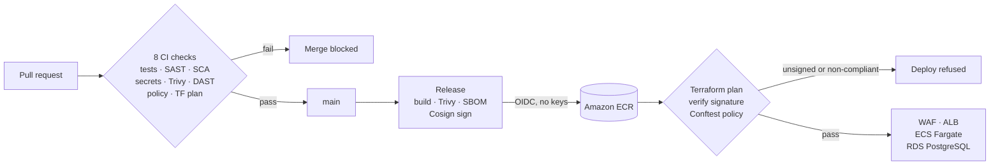

# Hi, I'm Abdurahim Yongho 👋

## DevSecOps · Cloud Security · Minneapolis-St. Paul, MN

I build cloud systems where security is part of the delivery path, not a report filed afterwards. A failing scan stops the merge, an unsigned image never reaches production, and every claim in my READMEs links to the evidence behind it.

Cybersecurity student at Metropolitan State University, with an A.S. in Software Application Development and a background in HIPAA-regulated compliance work.

### 🔎 Currently looking for

DevSecOps and cloud security **internships or entry-level roles** where I can help teams ship secure-by-default pipelines and infrastructure.

---

## 📂 Featured projects

| Project | What it is | Technologies | Status |
|---|---|---|---|
| **[MediBook](https://github.com/abdurahim50/medibook)** | Secure patient appointment-booking API on AWS with a signed, policy-gated delivery pipeline | Python · FastAPI · Terraform · ECS Fargate · RDS · GitHub Actions · Cosign · OPA |  |

*More projects are being rebuilt to the same evidence-first standard and will be added as they're ready.*

### MediBook in detail

A patient appointment-booking API on AWS, built end to end as a secure delivery exercise on synthetic data. Built across 28 merged pull requests.

- **Pipeline:** 8 required checks on every pull request: tests, SAST, dependency, secret and image scans, policy tests, authenticated DAST and a Terraform plan
- **Supply chain:** keyless Cosign signatures and SBOM attestation, pushed to ECR through GitHub OIDC with no stored AWS keys
- **Deploy gate:** Terraform verifies the image signature during the plan, and Conftest policies block non-compliant infrastructure
- **Data protection:** private, KMS-encrypted RDS PostgreSQL with verified TLS, IAM database auth and a least-privilege app role
- **Recovery:** point-in-time restore drilled and measured at an RTO of 23 min 50 s with no data lost
- **Governance:** controls mapped to NIST SP 800-53 Rev. 5, with a STRIDE threat model and known gaps tracked in the open

📄 [Architecture](https://github.com/abdurahim50/medibook/blob/main/docs/architecture.md) · [Threat model](https://github.com/abdurahim50/medibook/blob/main/docs/threat-model.md) · [NIST controls](https://github.com/abdurahim50/medibook/blob/main/docs/controls.md) · [Evidence](https://github.com/abdurahim50/medibook/blob/main/docs/evidence.md) · [Runbook](https://github.com/abdurahim50/medibook/blob/main/docs/runbook.md)

---

## 🎯 Skills mapped to DevSecOps job requirements

| Typical job requirement | Where to see it in MediBook |
|---|---|
| CI/CD with integrated security testing (SAST, SCA, DAST) | [CI workflow](https://github.com/abdurahim50/medibook/blob/main/.github/workflows/ci.yml): Bandit, Semgrep, pip-audit, gitleaks, Trivy, OWASP ZAP |
| Infrastructure as Code on AWS | [Terraform stacks](https://github.com/abdurahim50/medibook/tree/main/infra): VPC, ALB, WAF, ECS Fargate, RDS, CloudWatch |
| Policy as code and compliance | [Conftest policies](https://github.com/abdurahim50/medibook/tree/main/policy) mapped to NIST SP 800-53 |
| Container security | Multi-stage, non-root, read-only image pinned by digest; Trivy gate |
| Software supply-chain security | [Release workflow](https://github.com/abdurahim50/medibook/blob/main/.github/workflows/release.yml): Syft SBOM, Cosign signing, OIDC to ECR |
| IAM and least privilege | Read-only CI plan role, RDS IAM auth, row-access-only database role |
| Threat modeling and secure design | [STRIDE threat model](https://github.com/abdurahim50/medibook/blob/main/docs/threat-model.md) |
| Monitoring, incident response, recovery | [Runbook](https://github.com/abdurahim50/medibook/blob/main/docs/runbook.md) and [recovery drills](https://github.com/abdurahim50/medibook/blob/main/docs/evidence/deployment/recovery-drills.md) |
| Secure application development | FastAPI with argon2id hashing, session revocation, rate limiting, audit logging, security headers |

---

## 🛠️ Tech stack

**Cloud & IaC:** AWS (ECS Fargate, RDS, ECR, WAF, IAM, KMS, CloudWatch) · Terraform

**CI/CD & supply chain:** GitHub Actions · Docker · Cosign · Syft (SBOM) · Conftest/OPA

**Security testing:** Bandit · Semgrep · pip-audit · gitleaks · Trivy · OWASP ZAP · Nmap · Wireshark · Nessus

**Languages:** Python · Bash · HCL · Rego · YAML · SQL

---

## 🔭 What I'm working on

- Next MediBook milestones: Terraform modules for a second environment, a clinic staff portal, and running migrations from CI
- Rebuilding earlier Kubernetes and Terraform projects to the same evidence-first standard

---

## 🤝 Let's connect

Open to DevSecOps and cloud security roles and internships. Happy to talk about pipeline security, Terraform, or AWS.

👉 **Start with [MediBook](https://github.com/abdurahim50/medibook), then reach out on LinkedIn.**

[LinkedIn](https://www.linkedin.com/in/abdurahim-yongho/) · [Medium](https://yonghoabdurahim.medium.com/) · [dev.to](https://dev.to/abdurahim50) · [X](https://x.com/AYongho)

He/Him · ⚡ I once ran a half marathon with no training, purely to win a bet.
