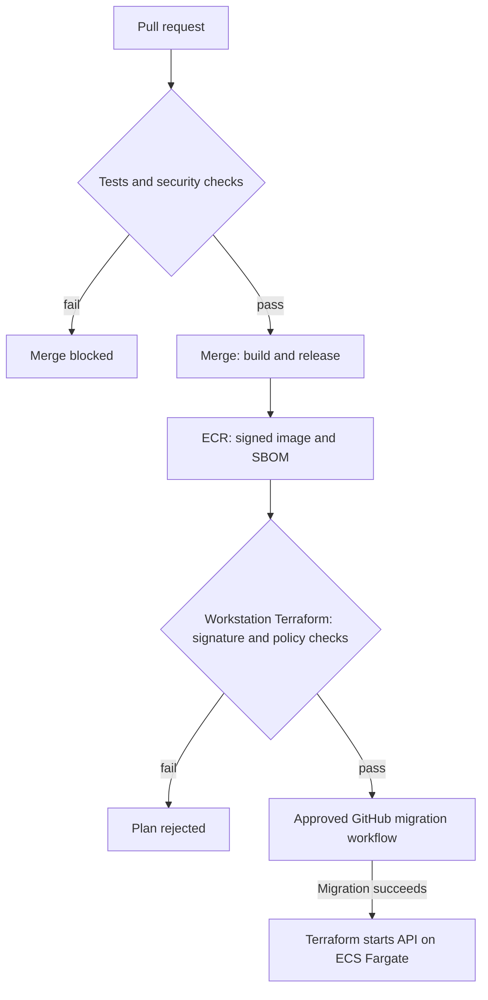

# Hi, I'm Abdurahim Yongho 👋

## DevSecOps · Cloud Security · Minneapolis-St. Paul, MN

I build cloud applications and delivery pipelines with security checks, least-privilege access, and recovery testing. MediBook brings those pieces together, with links to code, deployment records, and the gaps I still need to address.

Cybersecurity student at Metropolitan State University, with an A.S. in Software Application Development and a background in HIPAA-regulated compliance work.

### 🔎 Currently looking for

DevSecOps and cloud security **internships or entry-level roles** where I can help teams ship secure-by-default pipelines and infrastructure.

---

## 📂 Featured projects

| Project | What it is | Technologies | Status |
|---|---|---|---|
| **[MediBook](https://github.com/abdurahim50/medibook)** | Patient booking API on AWS with image signing, Terraform policy checks, and approved database migrations | Python · FastAPI · Terraform · ECS Fargate · RDS · GitHub Actions · Cosign · OPA |  |

*More projects are being rebuilt to the same evidence-first standard and will be added as they're ready.*

### MediBook in detail

A patient appointment-booking API built with synthetic data and verified through automated tests and live AWS drills. The [engineering case study](https://github.com/abdurahim50/medibook/blob/main/docs/case-study.md) explains why I built it, the challenges I solved, and what I learned.

- **Pipeline:** pull requests run tests, SAST, dependency, secret and image scans, policy tests, authenticated DAST, and a Terraform plan. [CI workflow](https://github.com/abdurahim50/medibook/blob/main/.github/workflows/ci.yml).
- **Supply chain:** keyless Cosign signatures and SBOM attestations, published to ECR through GitHub OIDC without stored AWS access keys.
- **Deployment:** workstation Terraform plans verify the image signature and SBOM attestation; Conftest checks infrastructure policies before apply. Direct AWS API or console deployments can bypass these checks.
- **Migrations:** an approval-gated GitHub workflow uses a dedicated AWS role to run the migration task before the API starts. [Implemented delivery flow](https://github.com/abdurahim50/medibook/blob/main/docs/architecture.md#delivery-path).
- **Data protection:** private, KMS-encrypted RDS PostgreSQL with verified TLS, IAM database authentication, and a least-privilege application role.
- **Recovery:** drill 5 on October 9, 2026 measured **21 min 26 s** from data loss to verified recovery. [Drill results and limitations](https://github.com/abdurahim50/medibook/blob/main/docs/evidence/deployment/recovery-drills.md#drill-5-drill-4-repeated-after-hardening-2026-10-09).
- **Governance:** controls mapped to NIST SP 800-53 Rev. 5, with a STRIDE threat model and documented gaps.

The AWS dev environment is created for verification sessions and destroyed afterward. The CI badge reports workflow status on `main`. [Dev environment and production target](https://github.com/abdurahim50/medibook/blob/main/docs/architecture.md#dev-environment-versus-production).

View the delivery flow

For code or infrastructure releases and fresh dev deployments:

The [architecture walkthrough](https://github.com/abdurahim50/medibook/blob/main/docs/architecture.md) covers the full deployment sequence and remaining access-control limits.

📄 [Case study](https://github.com/abdurahim50/medibook/blob/main/docs/case-study.md) · [Architecture](https://github.com/abdurahim50/medibook/blob/main/docs/architecture.md) · [Threat model](https://github.com/abdurahim50/medibook/blob/main/docs/threat-model.md) · [NIST controls](https://github.com/abdurahim50/medibook/blob/main/docs/controls.md) · [Evidence](https://github.com/abdurahim50/medibook/blob/main/docs/evidence.md) · [Runbook](https://github.com/abdurahim50/medibook/blob/main/docs/runbook.md)

---

## 🎯 Skills mapped to DevSecOps job requirements

| Typical job requirement | Where to see it in MediBook |
|---|---|
| CI/CD with integrated security testing (SAST, SCA, DAST) | [CI workflow](https://github.com/abdurahim50/medibook/blob/main/.github/workflows/ci.yml): Bandit, Semgrep, pip-audit, gitleaks, Trivy, OWASP ZAP |
| Infrastructure as Code on AWS | [Terraform stacks](https://github.com/abdurahim50/medibook/tree/main/infra): VPC, ALB, WAF, ECS Fargate, RDS, CloudWatch |
| Policy as code and compliance | [Conftest policies](https://github.com/abdurahim50/medibook/tree/main/policy) mapped to NIST SP 800-53 |
| Container security | [Dockerfile](https://github.com/abdurahim50/medibook/blob/main/Dockerfile) and [ECS task configuration](https://github.com/abdurahim50/medibook/blob/main/infra/ecs.tf): non-root user, read-only filesystem, digest pinning, and scanning |
| Software supply-chain security | [Release workflow](https://github.com/abdurahim50/medibook/blob/main/.github/workflows/release.yml): Syft SBOM, Cosign signing, OIDC to ECR |
| IAM and least privilege | [Role configuration](https://github.com/abdurahim50/medibook/blob/main/infra/iam.tf) and [database role tests](https://github.com/abdurahim50/medibook/blob/main/tests/test_least_privilege.py): RDS IAM authentication, row-access-only application role, and separate migration permissions |
| Threat modeling and secure design | [STRIDE threat model](https://github.com/abdurahim50/medibook/blob/main/docs/threat-model.md) |
| Monitoring, incident response, recovery | [Runbook](https://github.com/abdurahim50/medibook/blob/main/docs/runbook.md) and [recovery drills](https://github.com/abdurahim50/medibook/blob/main/docs/evidence/deployment/recovery-drills.md) |
| Secure application development | [Application code](https://github.com/abdurahim50/medibook/tree/main/app) and [tests](https://github.com/abdurahim50/medibook/tree/main/tests): argon2id hashing, session revocation, ownership checks, rate limiting, audit logging, and security headers |

---

## 🛠️ Tech stack

**Cloud & IaC:** AWS (ECS Fargate, RDS, ECR, WAF, IAM, KMS, CloudWatch) · Terraform

**CI/CD & supply chain:** GitHub Actions · Docker · Cosign · Syft (SBOM) · Conftest/OPA

**Security testing:** Bandit · Semgrep · pip-audit · gitleaks · Trivy · OWASP ZAP · Nmap · Wireshark · Nessus

**Languages:** Python · Bash · HCL · Rego · YAML · SQL

---

## 🔭 What I'm working on

- Next MediBook milestones: Terraform modules for a second environment, a clinic staff portal, and AI-assisted intake
- Rebuilding earlier Kubernetes and Terraform projects to the same evidence-first standard

---

## 🤝 Let's connect

Open to DevSecOps and cloud security roles and internships. Happy to talk about pipeline security, Terraform, or AWS.

👉 **Start with [MediBook](https://github.com/abdurahim50/medibook), then reach out on LinkedIn.**

[LinkedIn](https://www.linkedin.com/in/abdurahim-yongho/) · [Medium](https://yonghoabdurahim.medium.com/) · [dev.to](https://dev.to/abdurahim50) · [X](https://x.com/AYongho)

He/Him · ⚡ I once ran a half marathon with no training, purely to win a bet.

